# Workflows

## 1. Load Readings

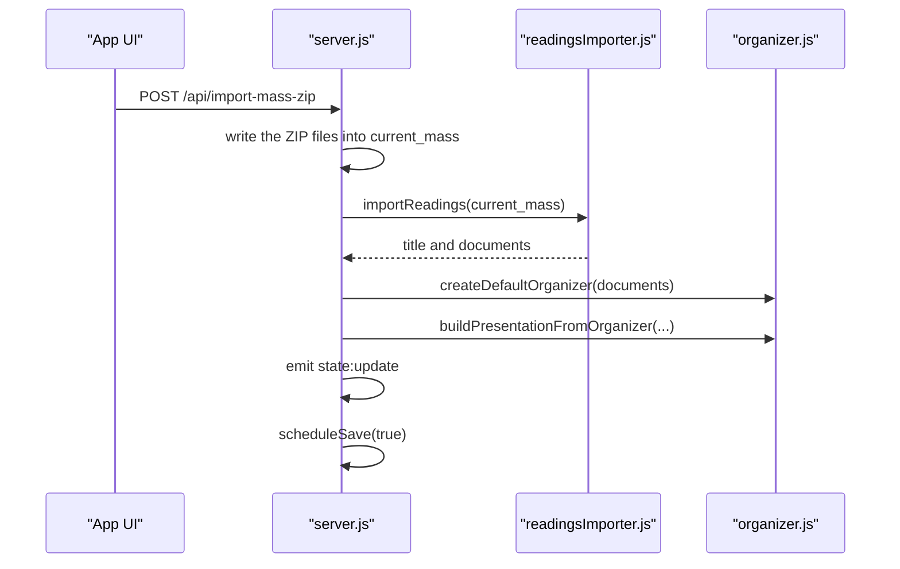

## 2. Update Organizer

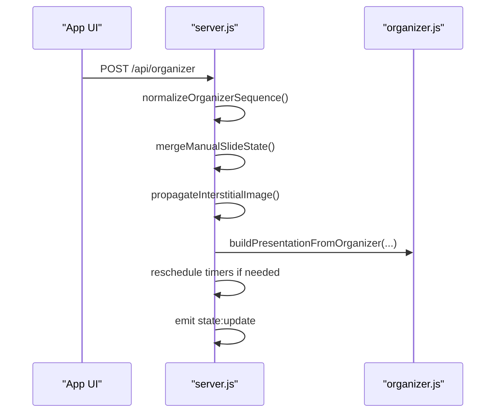

The body can include `organizerRevision`. When that value is present and it
is not the current revision, the server returns HTTP 409. It does not change
the Mass. The Digital Minister page then loads the current state. A body with no
`organizerRevision` still saves. A successful save adds 1 to the revision.

## 3. Countdown Handling

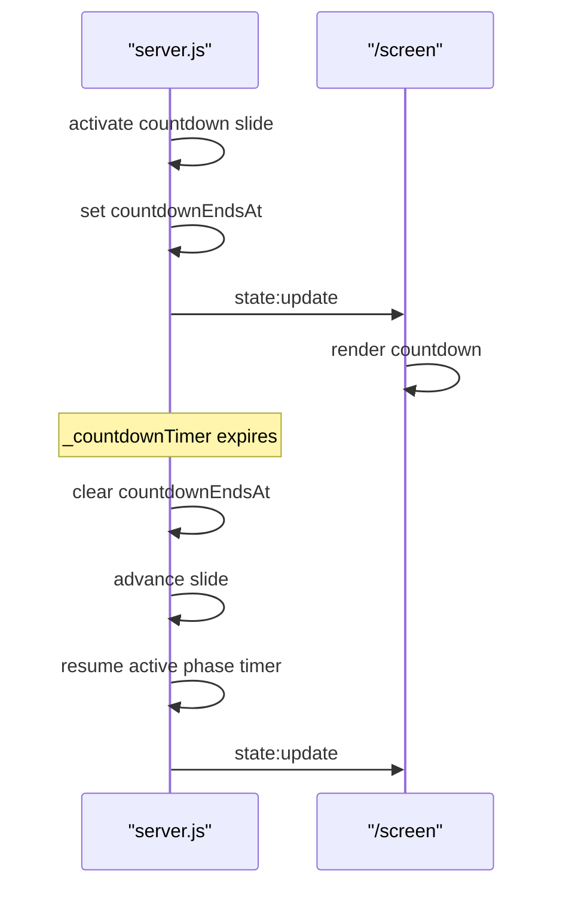

## 4. Interstitial Hold

The server handles `screen:interstitial-hold` from a control client. The current phone remote page does not send this event.

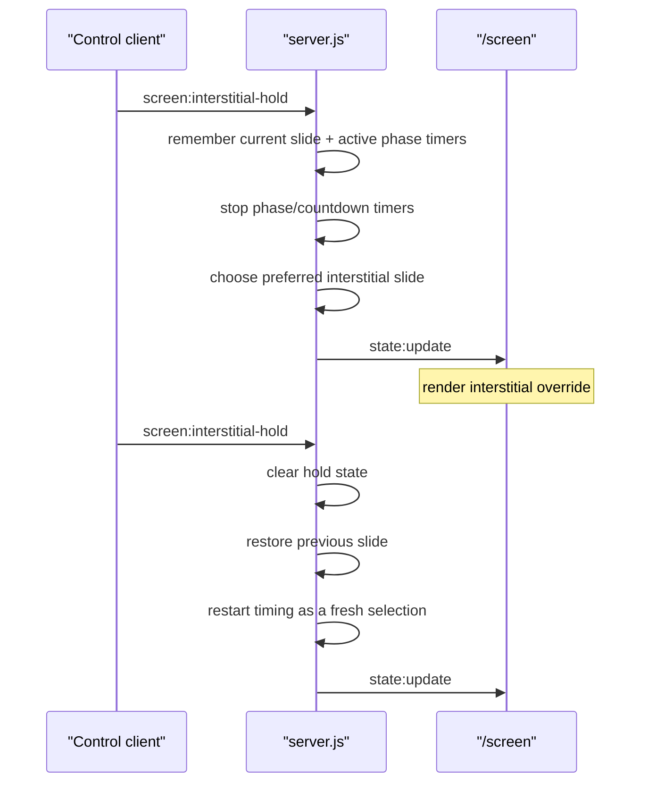

## 5. PIN-Gated Start

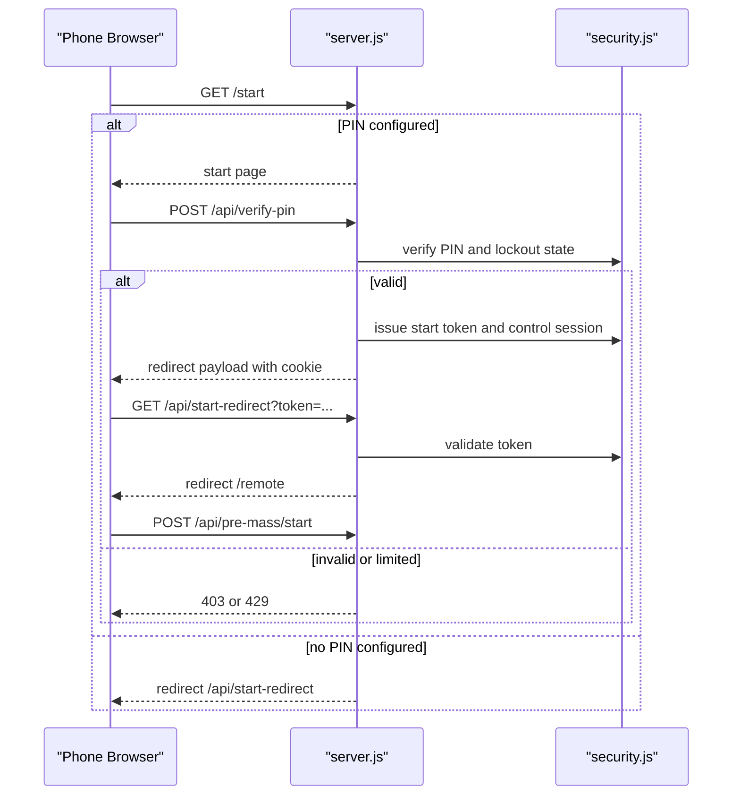

## 6. Control Authentication

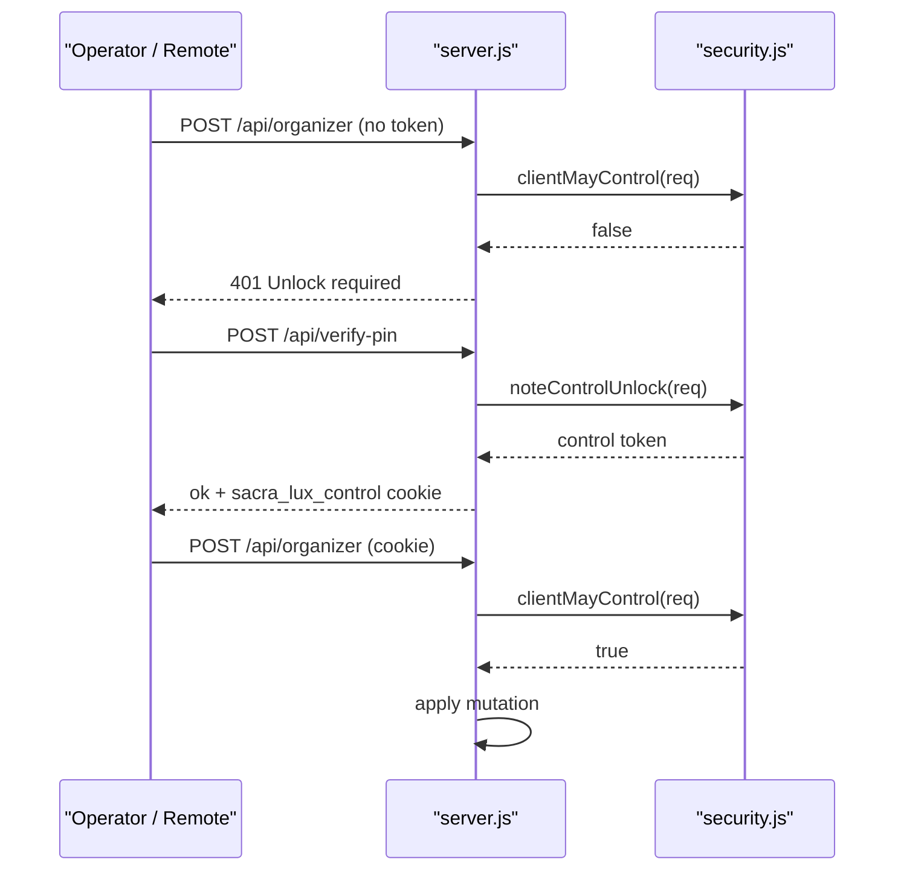

`POST /api/control-sessions/end` ends every control session except the
caller. Each ended socket receives `control:required` with
`The operator ended remote sessions.`
`control:lock` ends only the session of the remote that sent it.
That remote receives `This remote is locked.`
Other sessions stay valid.

## 7. Mass Asset Upload and Refresh

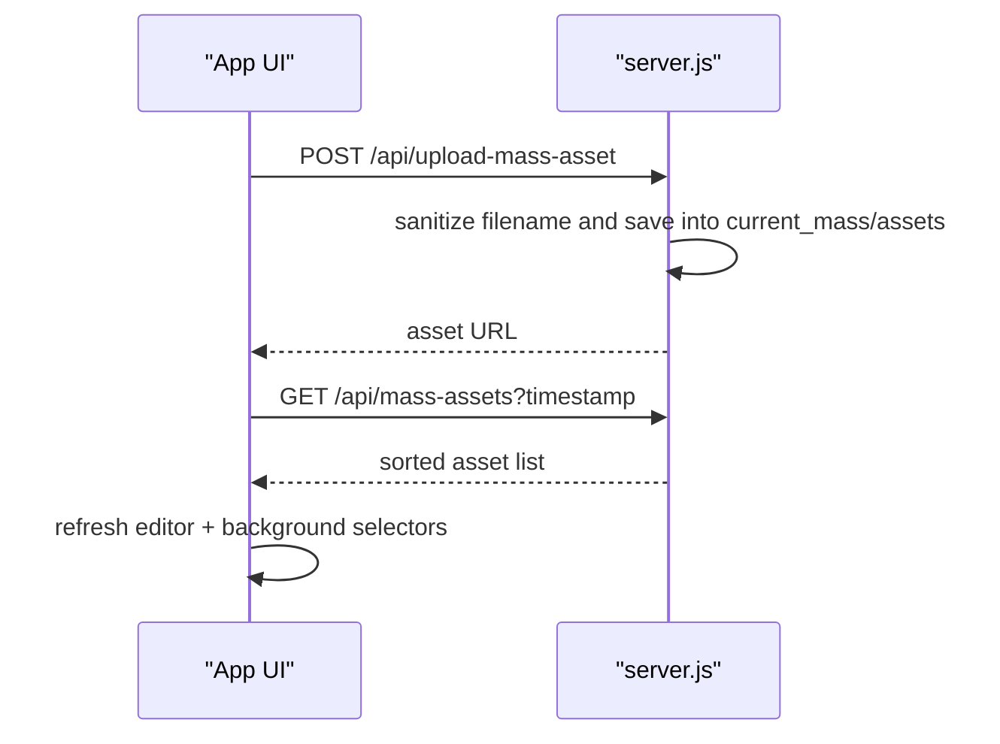

## 8. Image Slideshow Import and Play

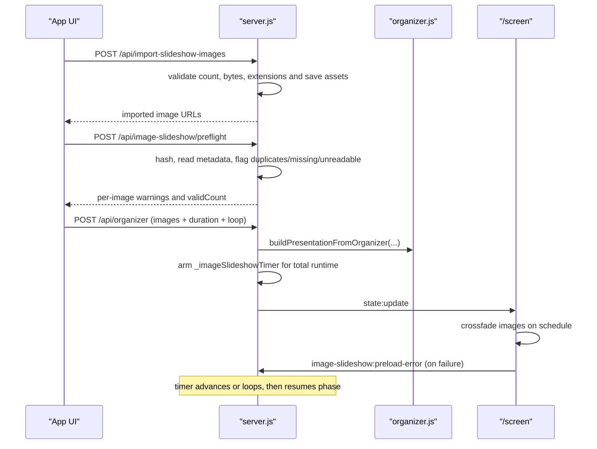

## 9. Movie Playback and Fallback

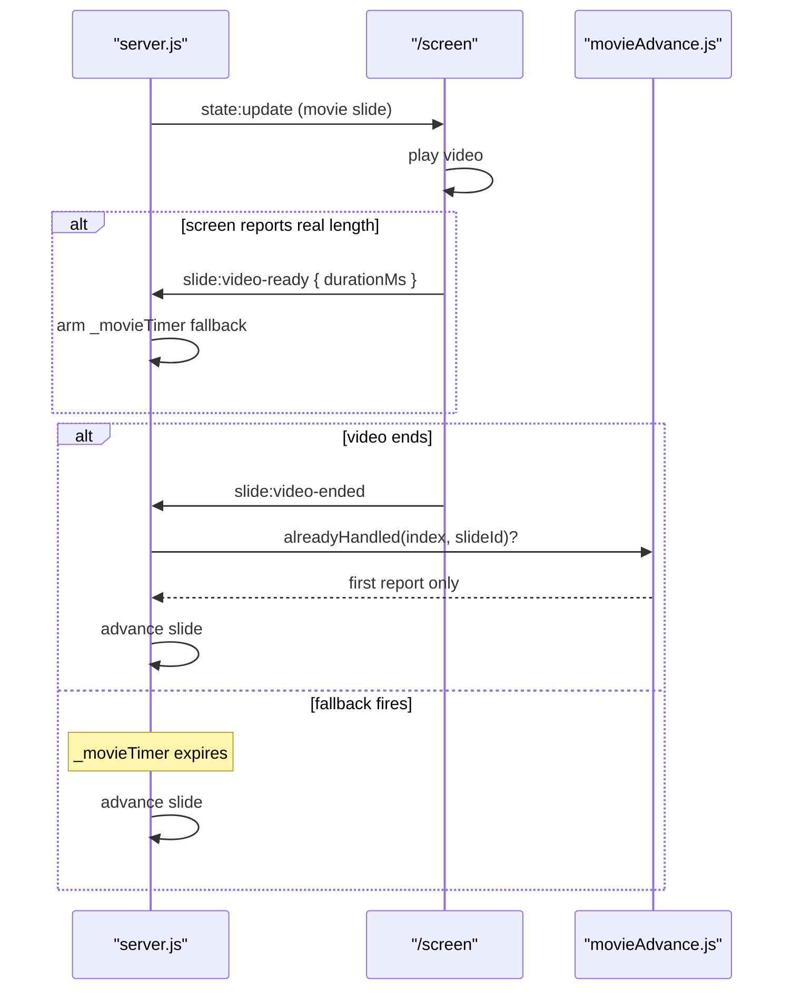

## 10. ZIP Import

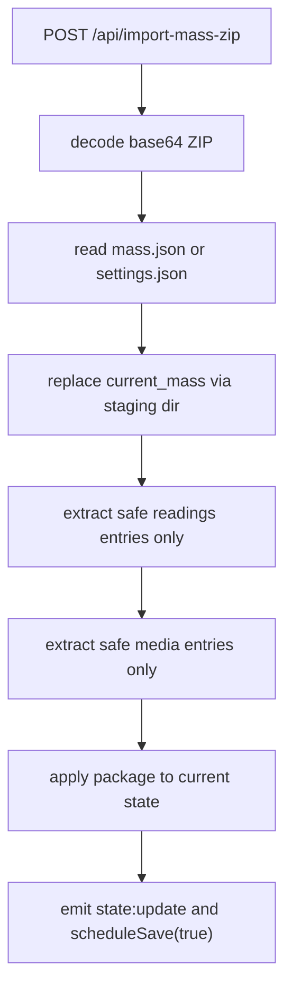

Unsafe nested or traversal-style ZIP entry paths are ignored, and the previous
package stays in place until the new package is fully written.

## 11. ZIP Export

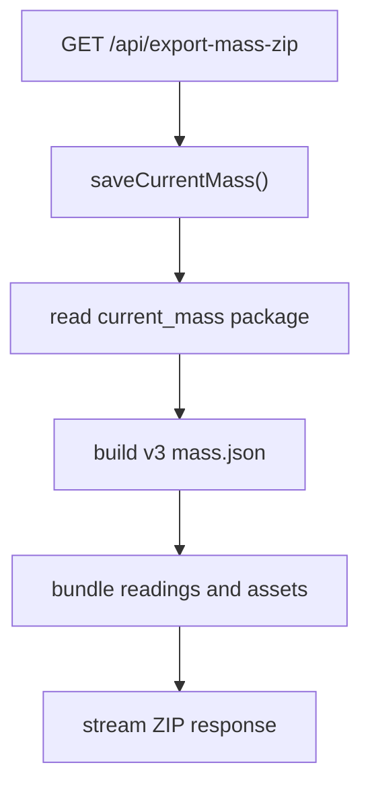

## 12. AVIF Export

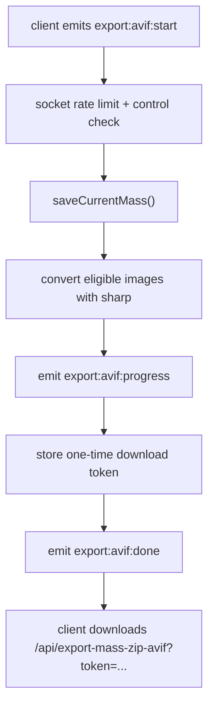

## 13. Archive Compression

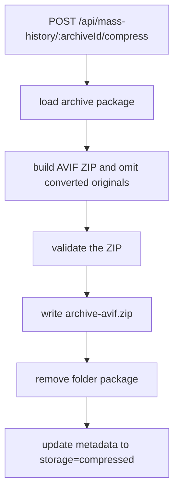

If validation fails, the folder package stays in place. A converted image is stored only as the AVIF file.

## 14. New Mass from USCCB Readings

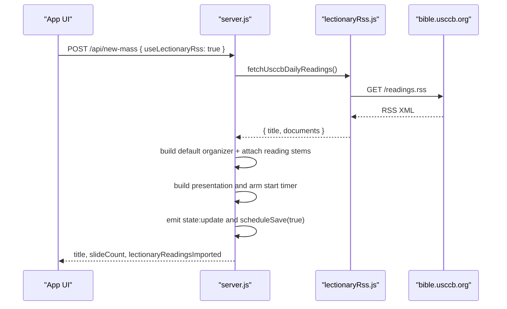

## 15. Session Restore

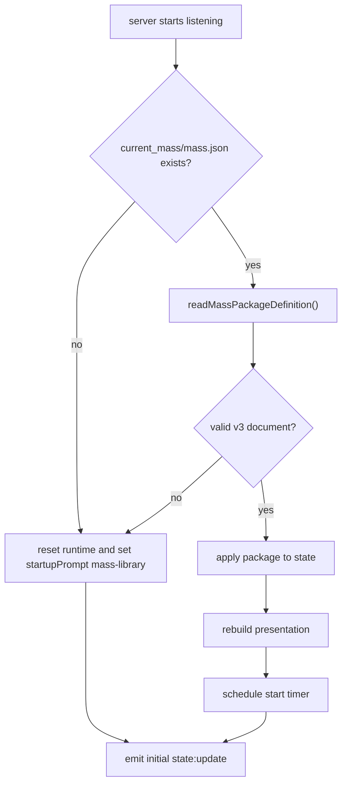
